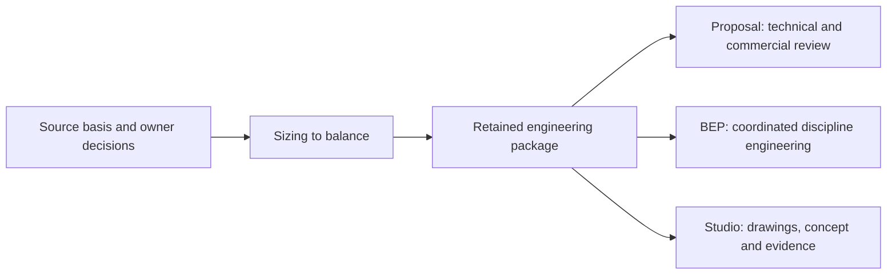

# PuranOS — engineering that remembers

PuranOS is the working system behind [Puran Water](https://puranwater.com/): industrial water, wastewater and waste-to-value process engineering, equipment support and operating investigations. Specialist agents use engineering tools and retained project records. Engineers review the basis and authorize release.

This repository is the public documentation companion. Selected calculation tools are released separately; the complete monorepo, customer records and internal configurations are private.

## One engineering basis, from proposal to basic engineering

`/sizing-to-balance` is the engineering core: unit coverage, heuristic pre-sizing, appropriate process simulation, recycle convergence and whole-plant balance. It retains the calculation basis, equipment identities, stream states, schedules and unresolved conditions for the revision.

`/proposal-workflow` builds the technical proposal and commercial offer from that package. `/bep-workflow` starts its discipline authoring and review loop from the sealed sizing basis. [Follow the workflow](docs/workflows.md).

## Review the design in PuranOS Studio

Studio presents retained process drawings, review-stage concept geometry, equipment properties, sizing evidence and associated lists. Linked appearances share engineering identity and a source revision. R1 supports BFD/balance review; R2 carries PFDs and lists; R3 brings P&IDs, concept geometry and the line list together.

Studio is an authorized review surface. It does not run a new design calculation or issue the engineering package. [Explore Studio](docs/studio.md).

## Meet the specialists

The owner coordinates work, with `pe-process` running the proposal and BEP procedures. Dedicated civil, piping and EHS personas work alongside CAD, mechanical, structural, electrical, automation, water-supply, separation, narrative and deliverables specialists. Cost estimation, procurement, finance, project management and operations connect engineering to delivery.

The former `pe-lead` persona is retired. [Current responsibilities and handoffs](docs/architecture/personas/README.md).

## Install a public engineering tool

| Repository | Calculation scope |
| --- | --- |
| [fluids-mcp](https://github.com/puran-water/fluids-mcp) | Pipe flow, pipe and valve sizing, fluid properties and bounded sweeps. |
| [heat-transfer-mcp](https://github.com/puran-water/heat-transfer-mcp) | Heat exchangers, air cooling, heat loss, insulation and thermal properties. |
| [water-chemistry-mcp](https://github.com/puran-water/water-chemistry-mcp) | PHREEQC speciation, mixing, saturation and chemical-dosing screens. |
| [corrosion-engineering-mcp](https://github.com/puran-water/corrosion-engineering-mcp) | Corrosion chemistry and model-specific screening with applicability limits. |
| [qsdsan-engine-mcp](https://github.com/puran-water/qsdsan-engine-mcp) | Dynamic treatment-process simulation, job state and numerical time series. |
| [watertap-engine-mcp](https://github.com/puran-water/watertap-engine-mcp) | Steady-state flowsheets using WaterTAP, IDAES and Pyomo with solver diagnostics. |
The six servers provide local MCP stdio entrypoints. Installation uses public Git sources, including the narrow `puran-mcp-support` package hosted inside the fluids repository. Each README contains an installation command, client configuration, known issues and licence inventory. PyPI publication is not part of the current installation path.

`v0.1.0` preserves the initial release. The default branch receives scoped improvements from PuranOS through a one-way mirror. Its source commit is recorded in `.puran-mirror.json`. Privacy, secrets, rights and packaging checks can refuse an export. Installed tools update only when the user reinstalls or upgrades them; pin both the server and support commits for repeatability.

Tools return calculations and structured evidence. The calling LLM interprets them and writes the explanation. The published packages do not include customer records, supplier pricing, internal project approvals or the complete proposal/BEP orchestration.

## Other public repositories

- [autocad-mcp](https://github.com/puran-water/autocad-mcp): Windows AutoCAD LT automation and a separate headless DXF backend.
- [freecad-mcp](https://github.com/puran-water/freecad-mcp): a FreeCAD integration fork; its add-on and runtime are required.
- [pandid](https://github.com/puran-water/pandid): a process-drawing fork; stream labels are supplied data, not a mass-balance calculation.
- [quetzal](https://github.com/puran-water/quetzal): a FreeCAD workbench fork with its own installation and upstream requirements.
- [docuseal-customizations](https://github.com/puran-water/docuseal-customizations): published source for the Docuseal customization, with its AGPL obligations.
- [adm1-mcp](https://github.com/puran-water/adm1-mcp) and [mathcad-mcp](https://github.com/puran-water/mathcad-mcp): earlier integrations. They are not members of the six-server automatic mirror.

Archived repositories retain historical implementations. Candidate archives may gain documentation notices while staying archived; a candidate is not a new release. Follow the active server READMEs for current installation.

[Built by Puran Water](https://puranwater.com/) · [Describe your engineering need](https://puranwater.com/contact/)

Each README provides the Git-based quick start, MCP client configuration, known issues and licensing. `v0.1.0` is the initial immutable release; current branches receive scoped improvements from the monorepo through the checked public mirror. The calling LLM interprets structured tool results and writes the report. [Distribution, updates and other public repositories](docs/public-tools.md).

## Connect your team

- [Deliverables and customer handoff](docs/integration/deliverables.md): documents, structured information, identity and agreed access.
- [Public intake MCP](docs/integration/mcp.md): service discovery, project-fit checks and input checklists. Internal engineering tools and project records are separate surfaces.
- [Discuss a project](https://puranwater.com/contact/): bring the basis, the decision and the evidence available.

## Read further

[Architecture](docs/architecture/README.md) · [Execution and recovery](docs/architecture/agent-runtime/README.md) · [MCP scope](docs/architecture/mcp-servers/README.md) · [Connected records](docs/architecture/ontology-layers/README.md) · [Documentation index](docs/README.md)

The [revamped website](https://revamp.puranwater-com.pages.dev/puranos/) is a preview until its production launch. Workflow, Studio, persona and release descriptions were reviewed on November 7, 2026; [current-state notes](docs/current-state.md) identify the scope. Separately dated schema and qualification snapshots retain their original meaning.
