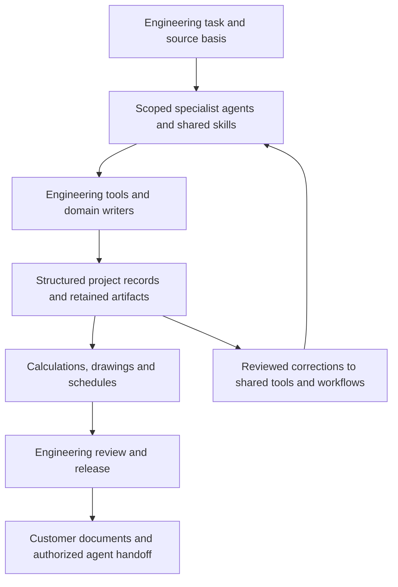

# PuranOS — engineering that remembers

PuranOS is the working system behind Puran Water’s industrial wastewater and waste-to-value engineering services. Specialist agents use engineering tools and retained project records to prepare calculations, drawings, equipment schedules, financial scenarios and operating investigations. Engineers review the basis and release the work.

This repository is the **public documentation companion**. It explains the architecture and integration approach; it does not distribute the private monorepo or grant access to customer projects.

## Start with the work

| Service | How the system contributes |
| --- | --- |
| Conceptual design | Source-bound feed characterization, connected balances, process alternatives and CAPEX/OPEX assumptions. |
| Process engineering | Shared equipment identities, calculations, CAD, schedules and document packages with review status. |
| Technology supply | Process requirements and vendor evidence retained separately for equipment selection and package interfaces. |
| Process optimization | Operating and maintenance evidence, model-based investigations and reviewed next actions. |

The useful memory is explicit: source inputs, model versions, equipment identity, decisions, unresolved questions and reviewed corrections. A later task can use those records without relying on the previous agent’s conversation.

## For customers and their agents

Engineering deliverables should remain useful after delivery. PuranOS workflows retain structured information alongside documents and schedules. The engagement defines the export formats, project scope and authorized interfaces a customer receives.

- [Agent-accessible deliverables](docs/integration/deliverables.md): identity, revisions, source information and a paired document/data example.
- [Connect an LLM](docs/integration/mcp.md): the live public MCP server and its actual capabilities.
- [Engineering services](https://puranwater.com/services/): what customers can engage Puran Water to deliver.

Public MCP endpoint: `https://intake.puranwater.com/mcp` (Streamable HTTP; no authentication for public discovery tools). It returns service scope, project-fit checks and input checklists. Private engineering records and simulation tools are separate, authorized surfaces.

## Architecture

OpenProject carries collaborative work. Runtime ledgers and durable workflow execution retain attempts and recovery state. Domain systems hold engineering and commercial records. Shared skills describe repeatable work; server policy and deployment permissions must enforce the actual access boundary.

## Read the documentation

- [Architecture overview](docs/architecture/README.md)
- [Specialist roles and handoffs](docs/architecture/personas/README.md)
- [MCP tools and access boundaries](docs/architecture/mcp-servers/README.md)
- [Identity and connected records](docs/architecture/ontology-layers/README.md)
- [Execution, recovery and reproducibility](docs/architecture/agent-runtime/README.md)
- [Engineering computation](docs/approach/engineering-engines.md)
- [How reviewed learning is retained](docs/approach/skills-as-expertise.md)
- [Documentation index](docs/README.md)

The updated website guides are linked to the **dev preview** while the production website remains on its existing release. The MCP endpoint itself is live.

## Evidence and scope

Reviewed October 19, 2026 against internal source commit `4850678d7340a67c4a86d808cabd14bb77c6430c`. [Source manifest](docs/source-snapshot.json) records the inspected source paths and hashes without publishing their private contents. [Current capability notes](docs/current-state.md) distinguish implemented workflows, public access and deployment-specific behavior.

The public schema catalog is a separately dated snapshot. A schema, configured persona or passing software check is not proof of engineering acceptance, standards certification, universal deployment or measured savings. Financial baselines, forecasts and actuals remain distinguishable; reviewed learning is human-directed.

[Puran Water](https://puranwater.com/) · [Connect your LLM](https://revamp.puranwater-com.pages.dev/connect/) · [Engineering Insights](https://puranwater.com/blog/)
