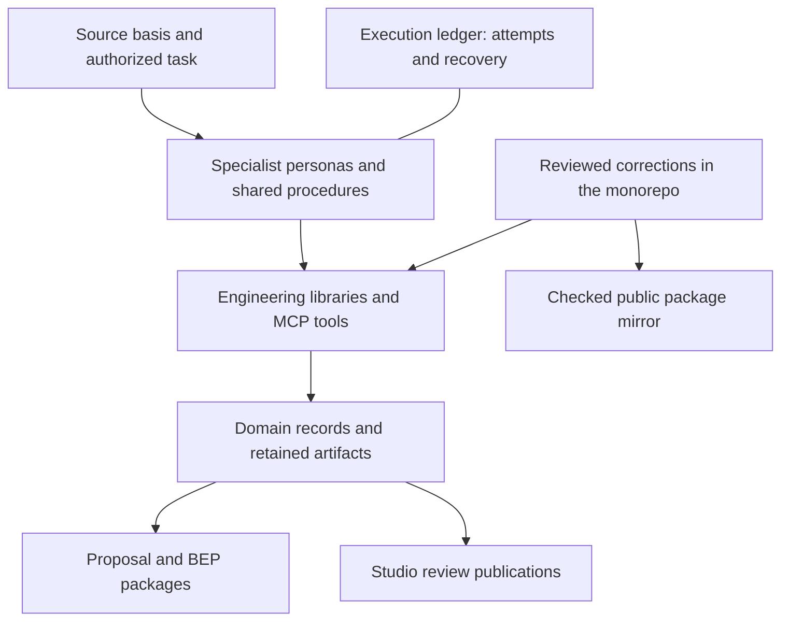

# PuranOS architecture

PuranOS connects specialist reasoning to engineering code, authoritative domain records and retained review evidence. The monorepo is the implementation source of truth; [public packages](../public-tools.md) expose selected calculation capabilities.

## Engineering continuity

[Sizing-to-balance](../workflows.md) produces the package that proposal and BEP procedures use. Source revisions, calculation evidence, equipment identity and stream states keep downstream documents attached to their engineering basis. Studio presents retained publications from those records.

Libraries own computations. MCP servers expose typed operations to agents. Agents interpret inputs, investigate findings and draft prose; domain writers and permissions govern persistence and consequential transitions. Review and issue remain distinct from calculation completion.

## State has an owner

Engineering records, commercial scope and business transactions live in their domain systems. Execution ledgers retain attempts, leases and recovery evidence. Project systems carry human-visible coordination. The configured system varies by entity: portfolio-company ERP and Puran Water project workflows do not share one blanket write authority.

Unstructured context lives in the knowledge layer with source links. It supplements the authoritative records rather than replacing them with a chat transcript.

## Role and access boundaries

[Specialists](personas/README.md) have defined responsibilities. The owner coordinates work; `pe-process` runs proposal and BEP procedures. Tool exposure and authenticated policy establish the actual actions each run can take.

[Runtime](agent-runtime/README.md) · [MCP surfaces](mcp-servers/README.md) · [Identity](ontology-layers/README.md) · [Studio](../studio.md)
