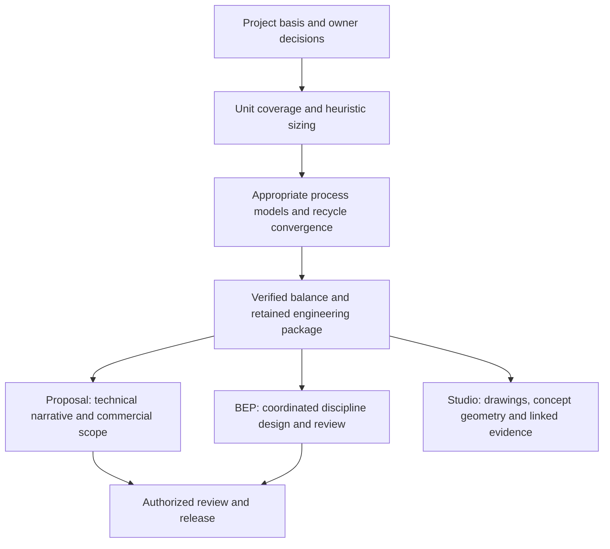

# From design basis to proposal and BEP

The repeatable engineering core is `/sizing-to-balance`. It is called for each scheme in `/proposal-workflow`; its retained, sealed package seeds `/bep-workflow`.

## Sizing to balance

1. Establish the source basis, required duties, approved topology and unresolved owner decisions.
2. Check coverage for every process unit. Missing shared model support is a named gap to resolve.
3. Produce heuristic pre-sizing. A rigorous model evaluates that specification where the duty and credibility requirement call for it.
4. Solve the connected plant, including return streams, residuals and applicable heat flows. Examine model warnings and convergence alongside closure.
5. Retain the engineering package, calculation references, equipment identities, schedules and transmittal evidence for that revision.

The workflow preserves computed requirements beside supplied equipment values. A missing input stays visible. A converged calculation does not convert an assumed feed or uncalibrated parameter into plant evidence.

The shared runner records attempts and verified checkpoints. Code and source pins connect a result to its actual calculation basis; a new project revision deliberately admits relevant changes. Models and dependencies have stated limits.

## Proposal workflow

`/proposal-workflow` sequences intake and owner decisions, library coverage, `/sizing-to-balance`, technical narrative and commercial preparation. Facts and tables are assembled deterministically. `pe-narrative` drafts named prose slots; `pe-process` reviews the technical text. Cost estimation prices the defined scope and retains the commercial assumptions separately.

The hand-back is a proposal and offer ready for authorized review, with a transmittal index and remaining conditions. Filing, sending and issuing are separate decisions.

## Basic Engineering Package

`/bep-workflow` starts from the sealed sizing package and runs the B0–B13 authoring and review loop. Discipline specialists contribute controlled records; checks identify missing or conflicting information; scoped repairs return to the responsible specialist. Independent review precedes the final Word master. The owner decides exceptions and issue.

This is how the proposal basis becomes coordinated basic engineering without silently replacing it with newer, unrelated project files.

## Review in Studio

[Studio](studio.md) presents retained publications from the same engineering identity and revision. Its review gates organize BFDs, PFDs, P&IDs, concept geometry and associated evidence. Seeing a publication in Studio is not a release certificate.

These command names describe PuranOS's internal procedures. They are not endpoints in the standalone public MCP servers. [Public tools and installation scope](public-tools.md).
